# AI Studio for Premiere Pro

A panel inside Adobe Premiere Pro where you make pictures and videos with AI without leaving your edit.

- **Upload a whole script** (PDF, Word or text, any language). Press **Analyse** and Claude splits it into episodes, scenes or ad shots, then writes the **image prompts** and **video prompts** for each one.
- **Everything the Seedance Production connector does:** lock reference images (faces are registered in BytePlus's private portrait library automatically), final Seedance prompts with frozen `@image` handles, a retry budget, review (approve, or reject with a note and Claude fixes the prompt), multiple projects, a project bible, and export to a Premiere sequence, an EDL and a manifest.
- **Batch processing:** make every image, lock, prompt and video across all episodes with one click, a few at a time, in the right order.
- **Uploads:** bring in your own script, images and videos, and tag them with the connector's choices (character, costume, location, prop, or a shot's reference image / first frame / last frame). Tag videos for BytePlus as motion, camera-move, style or performance references.
- **Assets:** see every character, costume, location or prop in one tap, or browse each episode as folders. Files on disk and bins in Premiere follow the same layout: `<project>/<episode>/<Characters|Costumes|Locations|Props|Shots|Uploads>`.
- **Models & costs:** choose the picture and video model and resolution; every button shows what it will cost, and Settings shows what you've spent by service, type and episode.
- **Ask Claude, everywhere:** *Change with Claude* on any picture or video ("make his shirt blue", "slower camera"), and an *Ask Claude* chat for ideas that knows what's open.
- **Claude** also turns a rough idea into a detailed prompt.
- **Higgsfield** makes pictures (Soul, Seedream) and turns them into video (DoP, Kling, Seedance).
- **BytePlus ModelArk** makes pictures with **Seedream 4.5** and videos with **Seedance 2.5**.
- Everything you make is saved on your computer and added to your Premiere project with one click.
- **MCP tab: the whole Seedance Production connector inside Premiere.** All 45 connector tools, its 4 workflows (*Start project*, *Prepare assets*, *Prepare unit*, *Review unit*), every skill and reference file, and every option. Claude drives the tools for you, and asks before anything costs credits.

| Upload a script | References (lock & upload) | Shots (review) | Batch |
|---|---|---|---|
| 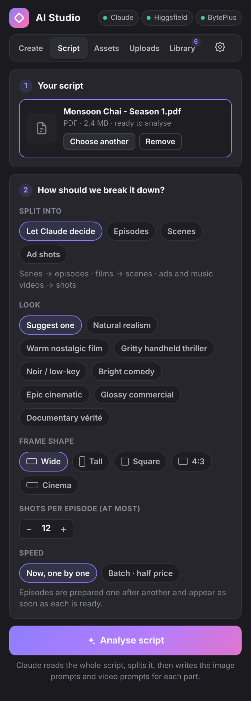 | 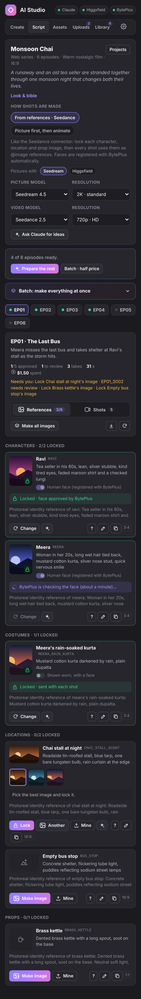 | 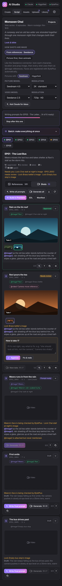 | 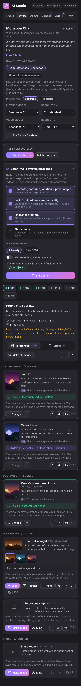 |

| Assets by type | Assets by episode | Uploads & tags | Change with Claude | Ask Claude |
|---|---|---|---|---|
| 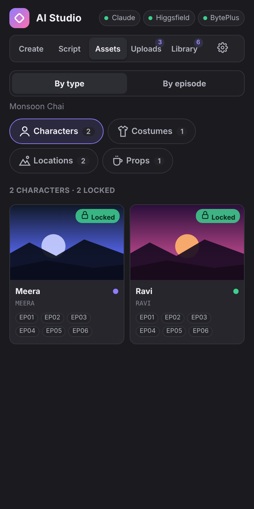 | 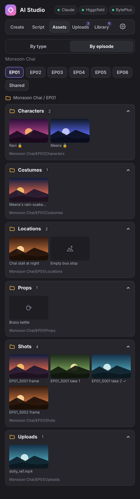 | 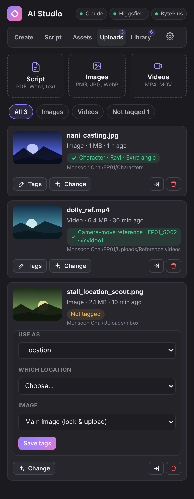 | 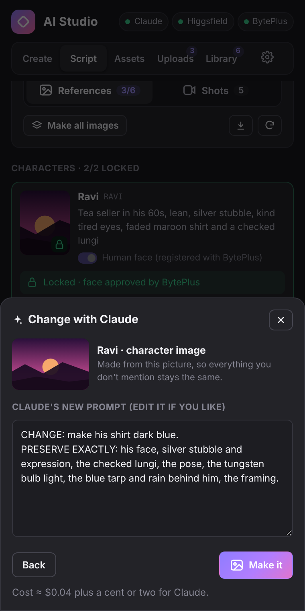 | 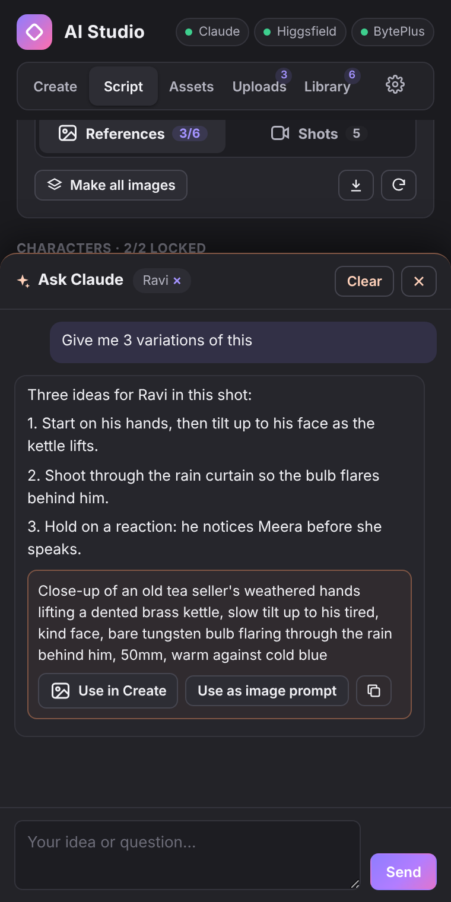 |

| Create | Library | Settings |
|---|---|---|
| 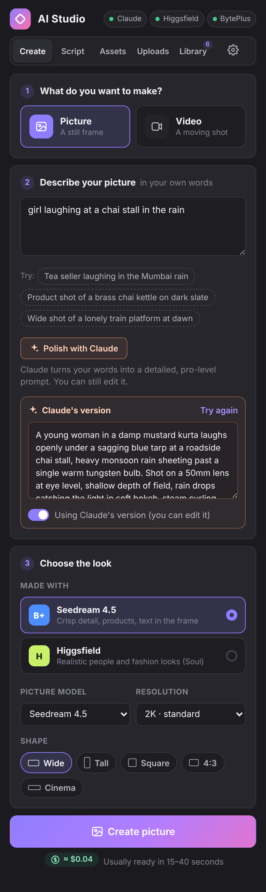 | 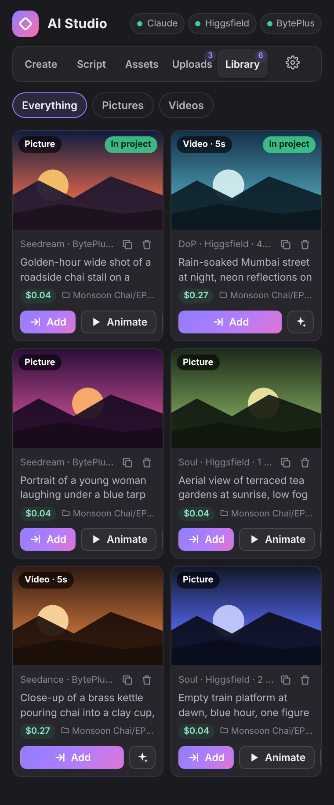 | 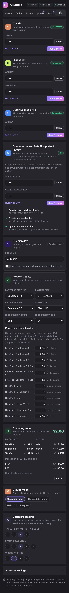 |

---

## What you can do

### Create: one picture or one video
1. Pick **Picture** or **Video**.
2. Describe it in your own words. Press **Polish with Claude** if you want Claude to rewrite it as a detailed prompt (you can still edit it).
3. Pick the service, the shape (wide, tall, square…) and for video the length and quality.
4. Press **Create**. Pictures take under a minute; videos take a few minutes, and you can keep editing meanwhile.
5. When it's done, press **Add to Premiere** or **Animate** (to turn a picture into a video).

### Script: a whole series, film or ad
This follows the same workflow as the Seedance Production connector.

1. **Upload your script**: PDF, Word (.docx) or text. Telugu, Hindi, Tamil and English all work. You can also paste it.
2. Choose how to split it (or let Claude decide: series → episodes, films → scenes, ads → shots), a **look** (8 presets, e.g. *Natural realism*, *Warm nostalgic film*, *Glossy commercial*), the frame shape and the most shots per episode.
3. Press **Analyse script**. Claude reads the whole script, works out what it is, lists the episodes with titles and summaries, and the recurring cast and places.
4. Then, for every episode, Claude writes:
   - **Image prompts** (Lira skill): every character, costume, location and prop. Characters are identity references, costumes garment-only, locations clean establishing views, props product-style. Anything already prepared in an earlier episode is reused, not rewritten.
   - **Video prompts** (Shotlist + CINEDANCE skills): the episode broken into shots of 4–15 s. Each shot has a **frame prompt** (its opening picture) and a **video prompt** (the motion), plus the characters and places it uses.
5. **Look & bible:** the project card shows the look and the bible Claude wrote (camera, lighting, performance, dialogue). Edit them any time; every prompt written afterwards follows them.
6. **Save prompt sheet** (download button) writes a .txt with every image and video prompt of the episode, to paste anywhere.

**Speed:** *Now, one by one* shows each episode as soon as it's ready. *Batch · half price* sends all episodes to Claude's Message Batches service: half the cost, usually done within the hour. You can close the panel; it picks up the results when you come back.

**Projects:** every script becomes a project. **Projects** on the project card switches between them; **New script** starts another.

### References: lock, and they upload themselves
In **References**, each character, costume, location and prop collects candidate images: **Make image** (from its prompt), **Another** for more options, or **Mine** (from your computer or the Library). Tap a thumbnail to compare, then **Lock** the one you want. Locking uploads it automatically:

- **Faces** (characters, and costumes marked *shown worn*) are registered in **BytePlus's private virtual portrait library**, so Seedance doesn't block your AI characters as real people. The card shows *Uploading → BytePlus is checking the face → Locked · face approved*, or *Refused* with BytePlus's reason. The image goes by its own BytePlus link while that's fresh, otherwise through a private storage bucket that is emptied once BytePlus has its copy. An identical image already registered for that character is reused without using quota. Animals and creatures: switch off *Human face*.
- **Everything else** is locked and sent with each shot.

**Change** unlocks a reference so you can pick, make or upload another and lock again; it's re-registered. The old portrait goes on a cleanup list (**Settings → Character faces → Remove**), because unused portraits still count against your library limit (50 on the Entry tier).

### Shots, the connector way (From references · Seedance)
1. **Write final prompt**: Claude (CINEDANCE + Acting skills) writes the Seedance prompt with the shot's references as `@image1`, `@image2`… (characters first, then costumes, locations, props). The handles are frozen with the prompt, and the panel warns if the prompt uses a handle that isn't attached or skips one that is.
2. **Generate**: Seedance gets the locked references: `asset://…` for registered faces, the image itself for the rest. A shot waits while its faces are still being checked, and tells you which reference to lock if one is missing.
3. **Review**: approve the take, or write what's wrong ("she should look at him, not the camera") and press **Fix & redo**. Claude patches only what the note asks and a new take is made. Every take stays on the shot; tap one to view it.
4. **Retry budget**: each shot gets 3 takes by default (Settings → Batch processing). After that, **One more take** asks first.
5. **Continues**: shots that pick up exactly where the last one ended are marked, and Claude describes the end of the previous shot in the prompt.
6. **Build in Premiere** imports the approved takes in story order into a bin named after the episode and lays them on a new sequence (if your Premiere version doesn't allow that yet, they stay in the bin in order). **EDL** and **Manifest** save the edit list and a JSON record of every shot.

Prefer the simpler route, or using Higgsfield? Switch *How shots are made* to **Picture first, then animate**. Each shot then gets an opening frame (made with the shot's locked references as Seedream references), which is then animated.

### Batch processing
Open **Batch: make everything at once** on the Script tab. Tick what to make (reference images, *Lock & upload them automatically*, final shot prompts, shot videos), choose all episodes or just the current one, and press **Start batch**. The panel:
- runs a few at a time (set how many in **Settings → Batch processing**),
- does things in the right order: images → lock & upload → final prompts → videos, and videos wait until their faces are approved by BytePlus (on the picture-first route: images → frames → videos),
- shows progress at the bottom of every tab, with **Pause**, **Resume**, **Cancel waiting** and **Retry failed**,
- skips anything already made, unless you turn on *Also redo things already made*.

The **Make all images / Make all frames / Animate all** buttons on an episode use the same queue.

### Uploads: your own files, tagged like the connector
The **Uploads** tab has three buttons: **Script** (opens the script picker), **Images** and **Videos** (several at once). Uploads stay in this tab, apart from what the panel generates. Tag each one:

- **Images → Use as** *Character / Costume / Location / Prop*: pick which one (or **+ New…**), the episode, and **Main image (lock & upload)** or **Extra angle**; for characters and costumes, whether it shows a human face. A main image is locked and uploaded straight away (faces go to the BytePlus portrait library).
- **Images → Use as** *Shot image*: pick the episode and shot, and the role: **Reference image** (an extra `@image` on that shot), **First frame** or **Last frame**.
- **Videos → Tag for BytePlus**: *Motion*, *Camera-move*, *Style & look* or *Acting / performance reference*, then the episode and shot, and optionally what to take from it ("the slow dolly-in from 0:02"). The shot sends it to Seedance as `@video1` (up to 3 per shot), and Claude's prompt says what each one is for. Seedance fetches videos by link, so this needs either the BytePlus Access Key (a private 24-hour link) or Higgsfield connected.

Tagged files move into their folder: `<project>/<episode>/Characters`, `…/Uploads/Reference videos`, and so on.

### Assets: everything in one place
- **By type:** tap **Characters**, **Costumes**, **Locations** or **Props** to see every one in the project, with a lock dot and the episodes it appears in. Tap one to open its full card (lock, change, make another, Ask Claude).
- **By episode:** pick an episode (or *Shared*) to see its folders: Characters, Costumes, Locations, Props, Shots (frames and takes, ✓ = approved) and Uploads. Each folder shows where it lives on disk, and **Add to Premiere** imports it into the matching nested bin (*AI Studio ▸ Monsoon Chai ▸ EP01 ▸ Characters*).

### Models, resolution and cost
- **Create** and the **Script** project card have **Picture model** / **Video model** and **Resolution** dropdowns (Seedream 4.5 / 4.0 at 1K, 2K or 4K; Seedance 2.5 / 1.0 Pro / Pro Fast / Lite at 480p, 720p or 1080p; Higgsfield Soul, Seedream, DoP, Kling, Seedance Pro). Any other model ID can be typed in Settings → Advanced.
- Every **Create**, **Generate** and **Batch** shows its cost before you press it (e.g. *≈ $0.27 · 108k tokens* for a 5 s 720p Seedance shot).
- **Settings → Models & costs** holds the price table behind those numbers. They're starting estimates; set them from your ModelArk console and Higgsfield plan. Seedance is priced by tokens (width × height × 24 fps × seconds ÷ 1024), Seedream per picture, Higgsfield in credits.
- **Settings → Spending so far** adds up every picture, video and Claude request by service, by type and, for the open project, by episode. Each episode's header shows what it has cost.

### Ask Claude and Change with Claude
- **Change with Claude** (✦ button on references, shot takes, Library and Create results, Uploads): say what should change in your own words, or tap a suggestion. You can read and edit Claude's new prompt before anything is made. For pictures on Seedream, the new one is made *from* the current picture with a CHANGE / PRESERVE EXACTLY prompt, so the rest stays the same; it's added as a new candidate you can lock. For a shot take, the note goes into the review: Claude patches the shot's prompt and a new take is made.
- **Ask Claude** (button at the bottom right, or **?** on any character or shot): a chat for ideas that knows the project, the episode and whatever you opened it from, and can see the selected picture. Prompts it suggests come with **Use in Create**, **Use as image prompt** (characters, locations…) or **Use as video prompt** (shots).

### MCP: the Seedance Production connector, inside Premiere
The **MCP** tab runs the same tools, workflows and skills as the Claude Desktop connector, on the panel's own projects (so the Script, Assets and Shots views update as it works). No Python, no server, nothing else to install.

- **Claude:** chat with Claude, which calls the connector's tools itself. The workflow buttons start the connector's four guided flows: **Start project** (read the script, decide series / film / ad, pick ratio, resolution and look, split it, write the bible), **Prepare assets** (Lira image prompts for a unit, then link the images), **Prepare unit** (Shotlist breakdown, then a CINEDANCE + Acting prompt for every shot) and **Review unit** (approve, or retry with notes and the prompt is patched). Before any tool that spends credits (`generate_shot`, `queue_unit`, `start_worker`, `generate_video`, `register_portraits`) or deletes portraits, it shows what it will cost and waits for **Approve**. Tick *Don't ask before spending credits* to skip that.
- **Tools · 45:** every tool, with its arguments. Edit the JSON and press **Run** to use one by hand (tools that spend credits ask for a second press).
- **Skills:** CINEDANCE, Shotlist Builder (with its 7 reference files and the HTML template), Acting System and Lira, exactly as Claude gets them from `get_skill`, plus the connector guide. Copy or save any of them.
- **Options:** project types and how each is divided, aspect ratios, resolutions, the 8 looks (with the bible text each sets, and **Use for this project**), shot transitions, reference-video tags, models, and where each connector setting lives in the panel.
- **Load script** loads a PDF, Word or text script into the open project (or starts a new one).

What's different from the desktop connector, because a Premiere panel can't run Python or read any path on disk: images come from the Library (or **pick** a file) instead of a folder, the background worker is the panel's batch queue (it runs while Premiere is open), and `export_unit` also builds the bin and sequence in Premiere. PDF scripts are read by Claude directly; `split_script` needs a text or Word script.

### Library
Everything you've made, with buttons to add it to your project, animate it, copy its prompt or delete it.

---

## Install (about 5 minutes)

You need **Premiere Pro 25.6 or newer** (the version that runs UXP panels).

**Quickest: the installer file.** Double-click `AI-Studio-1.1.0.ccx` (in `premiere/dist/`). Creative Cloud installs it; confirm the warning about a plugin from outside the Marketplace. Then in Premiere: **Window → UXP Plugins → AI Studio**. If Creative Cloud won't open it, use the developer route below.

**Developer route:**

1. Install **Adobe UXP Developer Tool** from the Creative Cloud app (search "UXP Developer Tool" under *All apps*).
2. Download this project (green **Code** button → **Download ZIP**) and unzip it.
3. Open UXP Developer Tool → **Add Plugin** → choose `manifest.json` in the unzipped folder.
4. With Premiere Pro open, press **Load** next to *AI Studio*.
5. In Premiere: **Window → UXP Plugins → AI Studio**. Dock the panel wherever you like.

To rebuild the installer after changing anything: `node tools/package-ccx.mjs` (writes `../dist/AI-Studio-<version>.ccx`). UXP Developer Tool's **••• → Package** makes the same file.

## Connect your accounts

Open the **Settings** tab and paste your keys. Press **Save & check** to make sure each one works.

| Service | What you need | Where to get it |
|---|---|---|
| Claude | API key (`sk-ant-…`) | [console.anthropic.com → API keys](https://console.anthropic.com/settings/keys) |
| Higgsfield | API key ID **and** secret, or the combined `KEY_ID:KEY_SECRET` in the first box | [cloud.higgsfield.ai](https://cloud.higgsfield.ai/) → API keys |
| BytePlus | ModelArk API key | [BytePlus console → ModelArk → API keys](https://console.byteplus.com/ark/region:ark+ap-southeast-1/apiKey) |
| Character faces (optional, recommended for Seedance) | BytePlus **Access Key ID + Secret** for an IAM user with `ArkFullAccess` and `TOSFullAccess` | BytePlus console → IAM → Users → Create user → Access keys. In ModelArk, activate *Dreamina Seedance Advanced Creation Rights* (free Entry tier, 50 portraits). |

You only need the services you plan to use. For example, Claude + BytePlus is enough for the whole workflow.

Your keys are stored in your computer's secure keychain (through UXP's secure storage) and are only sent to their own service.

**If a key is rejected:** under each box the panel shows which key is saved (first and last characters and its length), so a wrong or partial paste is easy to spot. Spaces, line breaks, quotes and whole lines like `ARK_API_KEY=…` or `Bearer …` are removed automatically when you save. **Save & check** costs nothing and says what's wrong in plain words: an Access Key pasted where the ModelArk key goes, a key from the other ModelArk region (it tries BytePlus Southeast Asia and Volcengine and keeps the one that works), Higgsfield's two ways of sending the key (it tries both), or a Claude account that can't use the chosen model.

*Fixed in 1.1:* every saved key could come back corrupted after Premiere restarted (some versions return keychain values as UTF-16), so every service rejected it. Keys are now saved as UTF-8 and read back either way, with a fallback when the keychain refuses to store them. The Claude check also used to send a full prompt with beta options, so an account without them looked like a rejected key; it now just lists models.

---

## Good to know

- **Costs.** Every picture and video uses credits on that service. A Claude prompt costs about a cent or two on Opus 5.5, less on Sonnet or Haiku.
- **Model names.** Defaults: `seedream-4-5-251128`, `dreamina-seedance-2-5-260628`, `higgsfield-ai/soul/standard`, `higgsfield-ai/dop/standard`. If your account uses different ones, change them in **Settings → Advanced settings**. Any Higgsfield model id works there, and you can pass extra settings as JSON (for example `{"resolution": "1080p"}`).
- **Claude model.** Opus 5.5 by default. Sonnet 5.5 and Haiku 5.5 are faster and cheaper. If a safety check declines a request, the panel asks the Claude API to retry it on a fallback model automatically.
- **Where files go.** Results are downloaded to the panel's own data folder, then imported into a bin called *AI Studio* (rename it in Settings). Service links expire after about a day, but your copies don't.
- **Real-looking faces on Seedance.** BytePlus can refuse starting pictures that look like real people. The Seedance Production connector handles this with BytePlus's private portrait library; this panel shows the refusal in plain words instead.

## Prompt skills

Claude uses the same prompt-writing skills as the Seedance Production connector, in [`skills/`](skills):

- `cinedance-prompt-builder.md`: every final Seedance prompt, and repairs (CINEDANCE v4.4.2)
- `shotlist-builder/`: breaking a unit into shots (`SKILL.md`, 7 reference files on camera–emotion, micro-beats, plan types, prompt density and patterns, spatial blocking, style block, and the HTML template)
- `acting-system.md`: character profiles, performance paragraphs, voice prompts
- `lira-image-prompts.md`: picture prompts
- `connector-guide.md`: the connector's step-by-step guide

After editing one, run `node tools/build-skills.mjs` to repack them into `src/skills.generated.js`.

## For developers

No build step: plain HTML, CSS and JavaScript that UXP loads directly.

```
manifest.json            UXP manifest (Premiere Pro, panel entrypoint, permissions)
index.html, styles.css   the panel
src/platform.js          UXP / Premiere APIs (files, keychain, import), with browser fallbacks
src/store.js             settings, keys, library, storyboard
src/jobs.js              runs generations, downloads results, adds them to the library
src/production.js        script → episodes → image and video prompts (analyse, per-episode breakdown, Claude batches)
src/queue.js             batch processing queue (limits, dependencies, pause/retry)
src/docx.js              reads Word files (small zip + DEFLATE reader; UXP has no unzip)
src/views/script.js      the Script tab
src/views/assets.js      the Assets tab (by type / by episode folders)
src/views/uploads.js     the Uploads tab (upload + tag)
src/views/panels.js      Change with Claude sheet, Ask Claude drawer, dropdown helper
src/uploads.js           uploads, connector tag choices, reference videos for Seedance
src/changes.js           what an item is in the project, and how to change it
src/pricing.js           model lists, resolutions, cost estimates, spending log
src/references.js        candidates, lock / change, automatic upload + portrait registration
src/shots.js             @image handles, final prompts, takes, review, retry budget, EDL / manifest / sequence
src/services/portraits.js  BytePlus portrait library (OpenAPI V4 signing) + private TOS bucket (TOS V4 signing)
src/crypto.js            SHA-256 / HMAC for request signing
src/services/*.js        Claude, BytePlus (Seedream/Seedance), Higgsfield clients
src/mcp.js               the Seedance Production connector: all 45 tools, 4 workflows, options
src/views/mcp.js         the MCP tab (Claude tool-use loop, tool runner, skills, options)
src/app.js               Create, Library, Settings, batch bar
src/demo.js              fake services for the browser preview
tools/preview.mjs        screenshots of every screen (Playwright)
tools/selftest.mjs       runs the real service code against fake servers
tools/package-ccx.mjs    builds the installable .ccx
```

- **Preview in a browser:** open `index.html?demo` for fake data, or `index.html` for the first-run view. API calls only work inside Premiere (browsers block them).
- **Checks:** `node tools/selftest.mjs` runs the real code against fake servers: generation, script analysis, Claude batches, the batch queue, locking and portrait registration (signatures checked against the formats of the connector and BytePlus's TOS SDK), `@image` shots, review, retry budget, export and projects. `node tools/preview.mjs screenshots/` saves screenshots.
- UXP's CSS has no grid, `gap` or `:has()`, so the styles stick to flexbox and margins.
